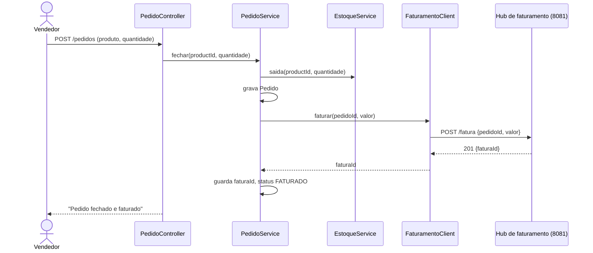

# Aula 08: Integração da venda (MVC) com o hub de faturamento (hexagonal)

## Implementação

A aplicação de vendas da aula 6 (`vendas/`, padrão MVC, porta 8080) passou a chamar por REST o hub de faturamento da aula 7 (`hexagonal/`, arquitetura hexagonal, porta 8081).

Ao **fechar um pedido**, a venda:

1. valida o pedido e dá baixa no estoque (reaproveitando as regras do `EstoqueService`);
2. grava o pedido no banco;
3. envia `POST http://localhost:8081/fatura` com `{ "pedidoId": ..., "valor": ... }`;
4. guarda no pedido o `faturaId` devolvido pelo hub e marca o pedido como **Faturado**.



### Arquivos principais (em `vendas/src/main/java/br/com/mvc`)

| Arquivo | Papel |
|---|---|
| `model/Pedido.java`, `model/PedidoStatus.java` | Pedido com valor, status e `faturaId` |
| `repository/PedidoRepository.java` | Persistência dos pedidos |
| `integration/faturamento/FaturamentoClient.java` | Cliente REST (`RestClient`) do hub, com timeouts de conexão e leitura |
| `integration/faturamento/FaturaRequest.java`, `FaturaResponse.java` | Contrato do `POST /fatura` |
| `service/PedidoService.java` | Regra de fechamento: baixa estoque, grava, chama o hub e guarda o ID |
| `controller/PedidoController.java` + `resources/view/pedidos.html` | Tela de pedidos |

A URL e os timeouts ficam em `application.properties` (`faturamento.url`, `faturamento.timeout-conexao`, `faturamento.timeout-leitura`).

Se a chamada falhar, o pedido **não se perde**: fica com status **Falha no faturamento**, a mensagem de erro aparece na tela e há o botão **Tentar faturar novamente**.

### Como executar

```bash
# Terminal 1: hub de faturamento (porta 8081)
cd aula-8/hexagonal
mvn spring-boot:run

# Terminal 2: aplicação de vendas (porta 8080)
cd aula-8/vendas
mvn spring-boot:run
```

Acesse `http://localhost:8080/home`, cadastre um produto, dê entrada no estoque e feche um pedido em **Pedidos**. Testes: `mvn test` dentro de `aula-8/vendas` (o hub é simulado com Mockito nos testes).

---

## Problemas

### Problema 1: hub indisponível ou lento

**Cenário:** o hub está fora do ar, reiniciando, sobrecarregado ou uma das integrações dele (fila do boleto, SOAP da nota, SMTP) está travada. A chamada da venda recebe conexão recusada ou fica esperando a resposta.

**O que acontece com o pedido:** a chamada é síncrona e acontece dentro do fechamento. Sem tratamento, a exceção desfaria toda a operação (estoque e pedido) ou, pior, a requisição ficaria presa até o timeout padrão do sistema, segurando uma thread do servidor e uma transação aberta no banco. Na implementação atual o pedido é gravado com status **Falha no faturamento** e sem `faturaId`: a venda existe, o estoque já saiu, mas não há fatura, boleto nem nota fiscal.

**O que o negócio percebe:** o vendedor vê a tela demorar ou uma mensagem de erro no momento de fechar a venda; o cliente sai sem boleto e sem nota; o financeiro tem pedidos que não aparecem no faturamento e precisa de alguém reprocessando à mão. Se o hub fica lento por muito tempo, as requisições presas se acumulam e **a própria aplicação de vendas fica lenta ou cai** junto com o hub (falha em cascata), parando também o cadastro de produtos e o estoque.

### Problema 2: fatura emitida em duplicidade

**Cenário:** o hub recebe o pedido, cria a fatura, publica o boleto, emite a nota e envia o e-mail, mas a resposta não chega à venda: o timeout de leitura estoura (o hub demorou 6 s e o limite é 5 s) ou a conexão cai no caminho de volta.

**O que acontece com o pedido:** para a venda, a chamada falhou; o pedido fica como **Falha no faturamento**, sem `faturaId`. O vendedor clica em **Tentar faturar novamente** (ou um mecanismo automático de retentativa reenvia), e o hub, que não sabe que aquele `pedidoId` já foi faturado, cria **uma segunda fatura** com novo ID, novo boleto e nova nota fiscal. A venda guarda só o ID da segunda; a primeira fica órfã.

**O que o negócio percebe:** o cliente recebe dois e-mails com dois boletos para a mesma compra e pode pagar duas vezes; existem duas notas fiscais para uma única venda, o que gera problema fiscal e exige cancelamento de nota; o financeiro tem divergência entre pedidos e faturas e precisa fazer estorno. É o tipo de erro que afeta diretamente a confiança do cliente.

---

## Soluções

### Para o Problema 1: Circuit Breaker (com timeout e fallback)

**Solução:** envolver a chamada ao hub em um **Circuit Breaker** (por exemplo, Resilience4j), mantendo os timeouts curtos que já foram configurados no `FaturamentoClient` e um **fallback** que grava o pedido como "aguardando faturamento".

**Por que essa:** o maior risco do Problema 1 não é uma falha isolada, e sim o hub lento derrubar a aplicação de vendas. O timeout limita quanto tempo cada requisição espera; o circuit breaker vai além: depois de várias falhas seguidas ele **abre** e passa a responder na hora com o fallback, sem nem tentar chamar o hub. Isso libera as threads, protege a venda de falha em cascata e dá tempo para o hub se recuperar. Depois de um intervalo ele fica **meio aberto**, testa algumas chamadas e, se o hub respondeu, volta a **fechar**. O vendedor continua conseguindo fechar pedidos, que são faturados quando o hub voltar (pela retentativa já existente).

Uma retentativa automática simples (*retry*) sozinha não serviria aqui: com o hub sobrecarregado, repetir as chamadas aumenta a carga e piora o problema, além de agravar o Problema 2.

### Para o Problema 2: Idempotência no hub (chave de idempotência = `pedidoId`)

**Solução:** tornar o `POST /fatura` **idempotente**. A venda já envia o `pedidoId`, que identifica o pedido de forma única; o hub passa a consultar se já existe fatura para aquele `pedidoId` antes de criar uma nova (com uma restrição de unicidade na coluna `pedido_id` da tabela de faturas). Se já existir, devolve o **mesmo `faturaId`**, sem emitir outro boleto, outra nota ou outro e-mail.

**Por que essa:** em comunicação pela rede é impossível a venda saber se uma requisição sem resposta foi ou não processada; então retentativas sempre vão existir (manuais ou automáticas). A idempotência faz com que **repetir seja seguro**: quantas vezes o pedido for reenviado, o resultado é uma única fatura, e a venda finalmente recebe e guarda o ID correto. Ela resolve a causa (o hub não reconhece um reenvio), em vez de tentar evitar reenvios, e também deixa seguras as retentativas do circuit breaker e do botão da tela. Na arquitetura hexagonal a mudança é localizada: uma consulta nova na porta `FaturaRepository` e uma verificação no `FaturaServiceImp`, sem mexer nos adaptadores de boleto, nota e e-mail.

---

## Resumo

| | Problema | Consequência para o negócio | Solução | Justificativa |
|---|---|---|---|---|
| 1 | Hub indisponível ou lento | Venda sem fatura; tela travada; vendas cai junto com o hub | Circuit Breaker + timeout + fallback | Corta a espera, isola a falha e evita cascata |
| 2 | Resposta perdida e reenvio | Fatura, boleto e nota em duplicidade | Idempotência pelo `pedidoId` | Torna o reenvio seguro: sempre uma única fatura |
